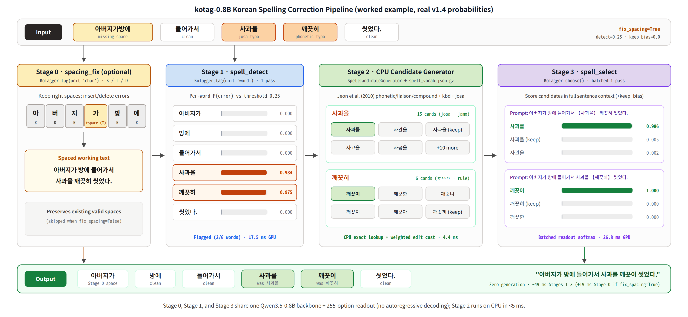
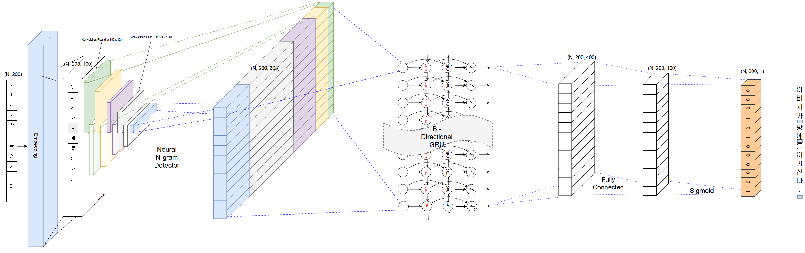
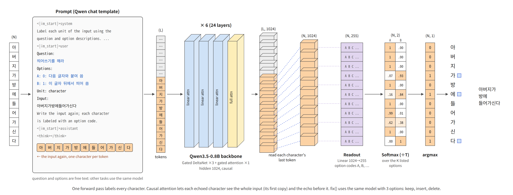
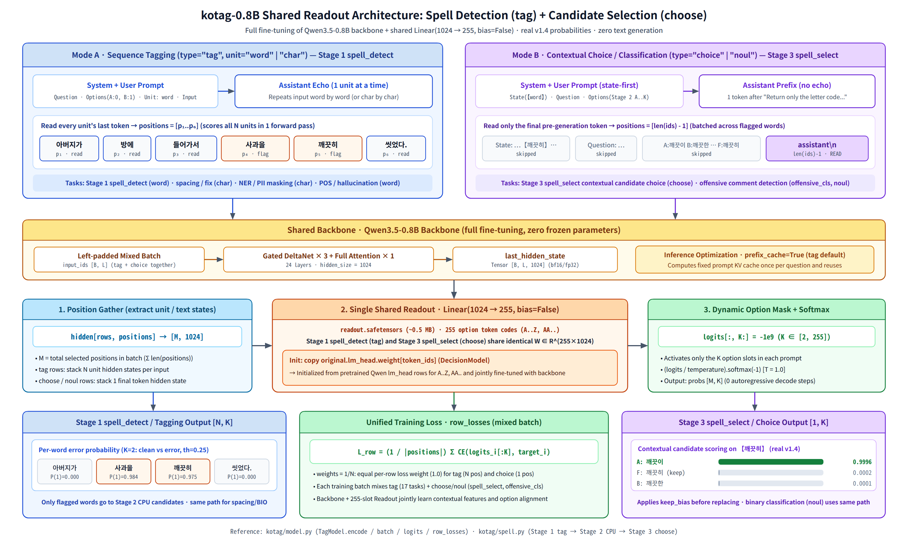

PyKoSpacing 
---------------

Python package for automatic Korean word spacing.

R verson can be found [here](https://github.com/haven-jeon/KoSpacing).

[](http://www.gnu.org/licenses/gpl-3.0)
[](https://huggingface.co/gogamza/kotag-0.8b)

> [!TIP]
> **New: KoSpacing v2.** An optional LLM-based backend, `Spacing(backend='v2')`, built on
> [kotag-0.8B](https://huggingface.co/gogamza/kotag-0.8b) (`v1.4`). It is more accurate than v1 on 3 of 4 test sets, fixes
> spacing that is already there (`fix()`), corrects Korean spelling and typing errors (`spell()`), and gives per-character probabilities.
> **[See KoSpacing v1 and KoSpacing v2 →](#kospacing-v1-and-kospacing-v2)**


#### Introduction

Word spacing is one of the important parts of the preprocessing of Korean text analysis. Accurate spacing greatly affects the accuracy of subsequent text analysis. `PyKoSpacing` has fairly accurate automatic word spacing performance,especially good for online text originated from SNS or SMS.

For example.

"아버지가방에들어가신다." can be spaced both of below.


1. "아버지가 방에 들어가신다." means  "My father enters the room."
1. "아버지 가방에 들어가신다." means  "My father goes into the bag."

Common sense, the first is the right answer.

`PyKoSpacing` is based on Deep Learning model trained from large corpus(more than 100 million NEWS articles from [Chan-Yub Park](https://github.com/mrchypark)). 


#### Performance (KoSpacing v1)

| Test Set  | Accuracy | 
|---|---|
| Sejong(colloquial style) Corpus(1M) | 97.1% |
| OOOO(literary style)  Corpus(3M)   | 94.3% |

- Accuracy = # correctly spaced characters/# characters in the test data.
  - Might be increased performance if normalize compound words. 


#### Install

##### PyPI Install
Pre-requisite:
```bash
proper installation of python3
proper installation of pip

pip install tensorflow
pip install keras


Windows-Ubuntu case: On following error.
On error: /usr/lib/x86_64-linux-gnu/libstdc++.so.6: version `GLIBCXX_3.4.22' not found
   sudo apt-get install libstdc++6
   sudo add-apt-repository ppa:ubuntu-toolchain-r/test
   sudo apt-get update
   sudo apt-get upgrade
   sudo apt-get dist-upgrade (This takes long time.)
```     
Darwin(m1) case: You should install tensorflow in a different way.(Use [Miniforge3](https://github.com/conda-forge/miniforge))
```bash
# Install Miniforge3 for mac
curl -O https://github.com/conda-forge/miniforge/releases/latest/download/Miniforge3-MacOSX-arm64.sh
chmod +x Miniforge3-MacOSX-arm64.sh
sh Miniforge3-MacOSX-arm64.sh
# Activate Miniforge3 virtualenv
# You should use Python version 3.10 or less.
source ~/miniforge3/bin/activate
# Install the Tensorflow dependencies 
conda install -c apple tensorflow-deps 
# Install base tensorflow 
python -m pip install tensorflow-macos 
# Install metal plugin 
python -m pip install tensorflow-metal
```

To install from GitHub, use

    pip install git+https://github.com/haven-jeon/PyKoSpacing.git


#### Example 

```python
>>> from pykospacing import Spacing
>>> spacing = Spacing()
>>> spacing("김형호영화시장분석가는'1987'의네이버영화정보네티즌10점평에서언급된단어들을지난해12월27일부터올해1월10일까지통계프로그램R과KoNLP패키지로텍스트마이닝하여분석했다.")
"김형호 영화시장 분석가는 '1987'의 네이버 영화 정보 네티즌 10점 평에서 언급된 단어들을 지난해 12월 27일부터 올해 1월 10일까지 통계 프로그램 R과 KoNLP 패키지로 텍스트마이닝하여 분석했다."
>>> # Apply a list of words that must be non-spacing
>>> spacing('귀밑에서턱까지잇따라난수염을구레나룻이라고한다.')
'귀 밑에서 턱까지 잇따라 난 수염을 구레나 룻이라고 한다.'
>>> spacing = Spacing(rules=['구레나룻'])
>>> spacing('귀밑에서턱까지잇따라난수염을구레나룻이라고한다.')
'귀 밑에서 턱까지 잇따라 난 수염을 구레나룻이라고 한다.'
```

Setting rules with csv file. (you only need to use `set_rules_by_csv()` method.)

```bash
$ cat test.csv
인덱스,단어
1,네이버영화
2,언급된단어
```

```python
>>> from pykospacing import Spacing
>>> spacing = Spacing(rules=[''])
>>> spacing.set_rules_by_csv('./test.csv', '단어')
>>> spacing("김형호영화시장분석가는'1987'의네이버영화정보네티즌10점평에서언급된단어들을지난해12월27일부터올해1월10일까지통계프로그램R과KoNLP패키지로텍스트마이닝하여분석했다.")
"김형호 영화시장 분석가는 '1987'의 네이버영화 정보 네티즌 10점 평에서 언급된단어들을 지난해 12월 27일부터 올해 1월 10일까지 통계 프로그램 R과 KoNLP 패키지로 텍스트마이닝하여 분석했다."
```

Run on command line(thanks [lqez](https://github.com/lqez)). 

```bash
$ cat test_in.txt
김형호영화시장분석가는'1987'의네이버영화정보네티즌10점평에서언급된단어들을지난해12월27일부터올해1월10일까지통계프로그램R과KoNLP패키지로텍스트마이닝하여분석했다.
아버지가방에들어가신다.
$ python -m pykospacing.pykos test_in.txt
김형호 영화시장 분석가는 '1987'의 네이버 영화 정보 네티즌 10점 평에서 언급된 단어들을 지난해 12월 27일부터 올해 1월 10일까지 통계 프로그램 R과 KoNLP 패키지로 텍스트마이닝하여 분석했다.
아버지가 방에 들어가신다.
```

Current model [have problems](https://github.com/haven-jeon/PyKoSpacing/issues/52) in some cases when the input includes English characters.<br>
PyKoSpacing provides the parameter `ignore` and `ignore_pattern` to deal with that problem.

- **About `ignore` parameter** (str, optional) <br>
  - `ignore='none'`: No pre/post-processing will be applied. The output will be the same as the model output. <br>
  - `ignore='pre'`: Apply pre-processing which deletes characters that match with `ignore_pattern`. These deleted characters will be merged after model prediction. This option has the problem that it always puts space *after* the deleted characters, since it doesn't know if the deleted character will have a space to the left, right, or both of them. <br>
  - `ignore='post'`: Apply post-processing which ignores model outputs on characters that match with `ignore_pattern`. This option has the problem that English characters in model input can also affect near non-English characters. <br>
  - `ignore='pre2'`: Apply pre-processing which delete characters which matches with `ignore_pattern`, and predict on **both preprocessed text and original text**. This allows it to know where to put space left, right, or both of the deleted characters. However, this option requires to predict **twice**, which doubles the computation time. <br>
  - Default: `ignore='none'`

- **About `ignore_pattern` parameter** (str, optional) <br>
You can input your own regex pattern to `ignore_pattern`. The regex pattern should be the pattern of characters you want to ignore.<br>
  - Default: ``ignore_pattern=r'[^가-힣ㄱ-ㅣ!-@[-`{-~\s]+,*( [^가-힣ㄱ-ㅣ!-@[-`{-~\s]+,*)*[.,!?]* *'``, which matches characters, words, or a sentence of non-Korean and non-ascii symbols.

Examples of `ignore` parameter

```python
>>> from pykospacing import Spacing
>>> spacing = Spacing()
>>> spacing("친구와함께bmw썬바이저를썼다.", ignore='none')
"친구와 함께 bm w 썬바이저를 썼다."
>>> spacing("친구와함께bmw썬바이저를썼다.", ignore='pre')
"친구와 함께bmw 썬바이저를 썼다."
>>> spacing("친구와함께bmw썬바이저를썼다.", ignore='post')
"친구와 함께 bm w 썬바이저를 썼다."
>>> spacing("친구와함께bmw썬바이저를썼다.", ignore='pre2')
"친구와 함께 bmw 썬바이저를 썼다."

>>> spacing("chicken박스를열고닭다리를꺼내입에문다.crispy한튀김옷덕에내입주변은glossy해진다.", ignore='none')
"chicken박스를 열고 닭다리를 꺼내 입에 문다. crispy 한튀김 옷 덕에 내 입 주변은 glossy해진다."
>>> spacing("chicken박스를열고닭다리를꺼내입에문다.crispy한튀김옷덕에내입주변은glossy해진다.", ignore='pre')
"chicken박스를 열고 닭다리를 꺼내 입에 문다.crispy 한 튀김옷 덕에 내 입 주변은glossy 해진다."
>>> spacing("chicken박스를열고닭다리를꺼내입에문다.crispy한튀김옷덕에내입주변은glossy해진다.", ignore='post')
"chicken박스를 열고 닭다리를 꺼내 입에 문다. crispy 한튀김 옷 덕에 내 입 주변은 glossy해진다."
>>> spacing("chicken박스를열고닭다리를꺼내입에문다.crispy한튀김옷덕에내입주변은glossy해진다.", ignore='pre2')
"chicken박스를 열고 닭다리를 꺼내 입에 문다. crispy 한 튀김옷 덕에 내 입 주변은 glossy해진다."

>>> spacing("김형호영화시장분석가는'1987'의네이버영화정보네티즌10점평에서언급된단어들을지난해12월27일부터올해1월10일까지통계프로그램R과KoNLP패키지로텍스트마이닝하여분석했다.", ignore='none')
"김형호 영화시장 분석가는 '1987'의 네이버 영화 정보 네티즌 10점 평에서 언급된 단어들을 지난해 12월 27일부터 올해 1월 10일까지 통계 프로그램 R과 KoNLP 패키지로 텍스트마이닝하여 분석했다."
>>> spacing("김형호영화시장분석가는'1987'의네이버영화정보네티즌10점평에서언급된단어들을지난해12월27일부터올해1월10일까지통계프로그램R과KoNLP패키지로텍스트마이닝하여분석했다.", ignore='pre')
"김형호 영화시장 분석가는 '1987'의 네이버 영화 정보 네티즌 10점 평에서 언급된 단어들을 지난해 12월 27일부터 올해 1월 10일까지 통계 프로그램R과KoNLP 패키지로 텍스트마이닝하여 분석했다."
>>> spacing("김형호영화시장분석가는'1987'의네이버영화정보네티즌10점평에서언급된단어들을지난해12월27일부터올해1월10일까지통계프로그램R과KoNLP패키지로텍스트마이닝하여분석했다.", ignore='post')
"김형호 영화시장 분석가는 '1987'의 네이버 영화 정보 네티즌 10점 평에서 언급된 단어들을 지난해 12월 27일부터 올해 1월 10일까지 통계 프로그램 R과 KoNLP 패키지로 텍스트마이닝하여 분석했다."
>>> spacing("김형호영화시장분석가는'1987'의네이버영화정보네티즌10점평에서언급된단어들을지난해12월27일부터올해1월10일까지통계프로그램R과KoNLP패키지로텍스트마이닝하여분석했다.", ignore='pre2')
"김형호 영화시장 분석가는 '1987'의 네이버 영화 정보 네티즌 10점 평에서 언급된 단어들을 지난해 12월 27일부터 올해 1월 10일까지 통계 프로그램 R과 KoNLP 패키지로 텍스트마이닝하여 분석했다."
```

#### KoSpacing v1 and KoSpacing v2

PyKoSpacing supports two backends:
- **KoSpacing v1** (`backend='v1'`, default): the original 2.4 MB TensorFlow CNN/BiGRU model, fast on CPU.
- **KoSpacing v2** (`backend='v2'`): [gogamza/kotag-0.8b](https://huggingface.co/gogamza/kotag-0.8b) (`v1.5`, Qwen3.5-0.8B with a shared 255-option readout, PyTorch, no TensorFlow). Adds valid-space-preserving `fix()`, 3-stage Korean spelling correction (`spell()`, `v1.3+`), per-character `space_probs()`, and list batching.

```bash
pip install "pykospacing[v2] @ git+https://github.com/haven-jeon/PyKoSpacing.git"
```

```python
>>> from pykospacing import Spacing
>>> spacing = Spacing(backend='v2')        # downloads gogamza/kotag-0.8b (v1.5)
>>> spacing('아버지가방에들어가신다')
'아버지가 방에 들어가신다'
>>> spacing.fix('오늘은날씨가 정말좋 네요. 산책 가실분?')       # keeps valid spaces
'오늘은 날씨가 정말 좋네요. 산책 가실분?'
>>> spacing.spell('한국어 공부를 항랑 열심히 해야 되요.')        # detect -> CPU candidates -> contextual choice
'한국어 공부를 항상 열심히 해야 돼요.'
>>> spacing(['밥먹었어', '오늘날씨가좋다'])                     # batched
>>> spacing.space_probs('아버지가방에')                          # [(char, P(space after)), ...]
```

Setup, offline mode, spelling presets, and CPU/GPU notes: [docs/kospacing-v2.md](docs/kospacing-v2.md) · [한국어 모델 카드](https://huggingface.co/gogamza/kotag-0.8b/blob/main/README_ko.md).

**Word spacing (Word F1, all test sentences; `v1.5`):**

| Test set | KoSpacing v1 | KoSpacing v2 |
|---|---|---|
| Wikipedia, spaces removed | 0.824 | **0.849** |
| KLUE-NER validation (news, reviews), spaces removed | **0.788** | 0.774 |
| KOLD comments, spaces removed (writer's gold spacing) | 0.630 | **0.693** |
| Wikipedia noisy spacing (15% dropped, 6% added), v2 `fix()` | 0.820 | **0.921** |
| same, whole sentence exact | 0.264 | **0.522** |

*On noisy spacing, v1 is scored in its best mode (spaces removed then re-spaced; raw `as-is` gives `0.730 / 0.140`).*

**Korean spelling correction (`spacing.spell()`, `gogamza/kotag-0.8b` v1.5):**



*Worked example (`fix_spacing=True`; real `v1.4` probabilities across Stage 0 `fix()` → Stage 1 detect → Stage 2 CPU candidates → Stage 3 contextual choice).*

| Benchmark | Precision | Recall | Edit F1 | Sentence exact | Clean preserved |
|---|---|---|---|---|---|
| Synthetic test (`1,000` sents, `1,212` errors; default `0.25 / 0.0`) | 0.840 | 0.626 | **0.717** | 0.612 | 98.1% |
| Synthetic test (`1,000` sents; safe `0.35 / +0.5`) | 0.854 | 0.603 | **0.707** | 0.597 | **99.6%** |
| Curated confusables & typos (`45` sents; default `0.25 / 0.0`) | 0.939 | 0.939 | **0.939** | 0.933 | 91.7% |
| Realistic multi-error & minimal pairs (`42` sents; default `0.25 / 0.0`) | 0.900 | 0.871 | **0.885** | 0.881 | 89.5% |

*`v1.5` highlights (`r3t-spell-v6b-s50` + `vocab_v6` + tightened `spell_candidates.py`, zero heuristic guards): Wikipedia spacing **0.849**, test precision **0.803 → 0.840**, edit F1 **0.699 → 0.717**, clean preservation **96.2% → 98.1%** (5/260 FP; safe **99.6%**, 1/260 FP), and **65–75%** fewer total FPs across 386 unseen live web sentences in `fix_spacing=True` mode. See [docs/kospacing-v2.md](docs/kospacing-v2.md) for `spell()` presets, `return_edits=True`, offline use, and the web demos (`examples/demo_spell.py`, `examples/demo_writer.py`).*

**Speed & vs generative decoding (NVIDIA GB10, 20-core Arm CPU / GPU, `1.7 GB` weights in PyTorch):**

| Speed benchmark | v1 on CPU | v2 on CPU | v2 on CPU (`bf16`) | v2 on GPU |
|---|---|---|---|---|
| One sentence per call, median latency | 11 ms | 475 ms | 369 ms | **18 ms** |
| One sentence per call, throughput | 83 sents/s | 2.0 sents/s | 2.5 sents/s | **55 sents/s** |
| Batched list, throughput | – | 2.6 sents/s | 4.6 sents/s | **101 sents/s** |

| Spacing vs generative base model (`30` sents, ~58 chars, GB10 GPU) | Latency/sent | Generated tokens | Word F1 |
|---|---|---|---|
| KoSpacing v2: one forward pass, no generation | **18 ms** | 0 | **0.836** |
| Qwen3.5-0.8B (writes spaced text) | 586 ms | 48 | 0.326 |
| Qwen3.5-0.8B (writes JSON labels) | 6,975 ms | 422 | 0.006 (4/30 valid) |

- v2 uses `prefix_cache=True` by default, reads Latin/digits/symbols directly (`ignore=` is v1-only), and runs ~25× faster on GPU than CPU (`flash-linear-attention`; CPU model load `1.9 s`, GPU `11.5 s` with CUDA warm-up).
- Tests: `PYKOSPACING_V2_CHECKPOINT=... python -m unittest tests.test_v2` (details in [docs/kospacing-v2.md](docs/kospacing-v2.md)).

#### Model Architecture (KoSpacing v1)



#### Model Architecture (KoSpacing v2)



The prompt states the question and options, then echoes the input one character per token so a single forward pass scores all units (`gogamza/kotag-0.8b` v1.4).



The same fine-tuned `Qwen3.5-0.8B` backbone and 255-option readout serve both sequence tagging (`tag()`, spacing and Stage 1 `spell_detect`) and whole-text contextual choice (`choose()`, Stage 3 `spell_select`).


#### For Training (KoSpacing v1)

- Training code uses an architecture that is more advanced than PyKoSpacing, but also contains the learning logic of PyKoSpacing.
  - https://github.com/haven-jeon/Train_KoSpacing

#### Citation

```markdowns
@misc{heewon2018,
author = {Heewon Jeon},
title = {KoSpacing: Automatic Korean word spacing},
publisher = {GitHub},
journal = {GitHub repository},
howpublished = {\url{https://github.com/haven-jeon/KoSpacing}}
```

The Hangul phonetic cost matrix, syllable-boundary liaison cost, and compound-noun split correction used in `spacing.spell()` candidate generation follow:

```bibtex
@inproceedings{jeon2010analyzing,
  title={Analyzing of hangul search query spelling error patterns and developing query spelling correction system based on user logs},
  author={Jeon, Hee-Won and Huang, Daniel and Rim, Hae-Chang},
  booktitle={Annual Conference on Human and Language Technology},
  pages={15--21},
  year={2010},
  organization={Human and Language Technology}
}
```

### Star History

[](https://star-history.com/#haven-jeon/PyKoSpacing&Date)


