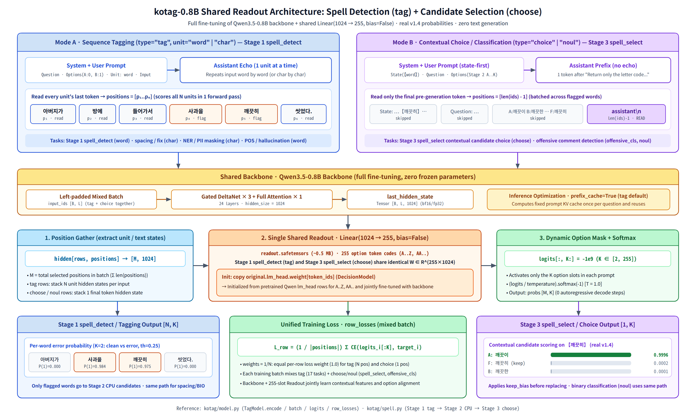

# KoSpacing v2 setup guide

KoSpacing v2 is the second spacing model of PyKoSpacing: Qwen3.5-0.8B fine-tuned to label every character or word of
the input (`Spacing(backend='v2')`). KoSpacing v1, the original TensorFlow model, stays the default.
This guide covers installing v2, choosing a checkpoint, offline use, spelling correction, and running it on GPU or CPU.

The model is published on the Hugging Face Hub as **`gogamza/kotag-0.8b`**, a general instruction-following
sequence tagger; PyKoSpacing uses it for spacing, spacing correction, and spelling correction under the name KoSpacing v2.
It is the default checkpoint of `backend='v2'`; the model card there describes the model, its other tasks and its limits.

## 1. Install

```bash
pip install "pykospacing[v2] @ git+https://github.com/haven-jeon/PyKoSpacing.git"
# torch, transformers>=5.17, safetensors, huggingface_hub; add @v0.6.1 to the URL to pin a release
```

- v2 does not import TensorFlow. Installing only the v2 extras is enough if you never use v1.
- On an NVIDIA GPU, also install the fast linear-attention kernels. Without them transformers runs Qwen3.5's
  linear-attention layers with slower reference code and prints a warning:

  ```bash
  pip install flash-linear-attention
  ```

- Tested with torch 2.14, transformers 5.17, huggingface_hub 1.31, Python 3.14.

## 2. Quick start

```python
from pykospacing import Spacing

spacing = Spacing(backend='v2')                  # gogamza/kotag-0.8b (v1.5)
spacing('아버지가방에들어가신다')                    # '아버지가 방에 들어가신다'
spacing.fix('오늘은날씨가 정말좋 네요.')             # '오늘은 날씨가 정말 좋네요.'
spacing.spell('한국어 공부를 항랑 열심히 해야 되요.')   # '한국어 공부를 항상 열심히 해야 돼요.'
spacing(['밥먹었어', '오늘날씨가좋다'])               # a list is spaced as one batch
spacing.space_probs('아버지가방에')                 # [('아', 0.0), ..., ('가', 0.89), ...]
```

The first call downloads `gogamza/kotag-0.8b` (about 1.7 GB, plus `spell_vocab.json.gz` 3.4 MB for spelling candidates)
to the Hugging Face cache; later calls load it from there.

## 3. Options

| `Spacing(...)` argument | Environment variable | Default | Meaning |
|---|---|---|---|
| `backend='v2'` | | `'v1'` | Selects KoSpacing v2 |
| `checkpoint` | `PYKOSPACING_V2_CHECKPOINT` | `gogamza/kotag-0.8b` | Hugging Face repo id, or a local checkpoint directory |
| `revision` | `PYKOSPACING_V2_REVISION` | `v1.5` for `gogamza/kotag-0.8b`, latest on `main` for other repos | Repo branch, tag or commit to use |
| `device` | `PYKOSPACING_V2_DEVICE` | `'cuda'` if available, else `'cpu'` | Where the model runs |
| `threads` | | torch default | CPU threads (CPU only) |
| `token_budget` | | 32768 | Padded tokens per forward pass; lower it if the GPU runs out of memory |
| `dtype` | | `'bfloat16'` on GPU, `'float32'` on CPU | Weight precision; `'bfloat16'` on CPU is faster |
| `prefix_cache` | | `True` | Run the prompt part before the text once and reuse it (same output) |
| `rules` | | `[]` | Words never split, as in v1 |

Arguments take precedence over environment variables. A value that starts with `.`, `/` or `~` is always a local
path; a missing directory raises `FileNotFoundError` instead of trying the Hub.

The default model is pinned: each PyKoSpacing version loads the kotag-0.8B release it was tested with
(`DEFAULT_REVISION` in `pykospacing/v2.py`, now `v1.5`), so a new upload to the repo does not change your results.
Pass `revision='main'` to try the newest upload, or pin a revision yourself when you use another repo:

```python
spacing = Spacing(backend='v2', revision='main')                                  # newest kotag-0.8B upload
spacing = Spacing(backend='v2', checkpoint='your/fine-tuned-repo', revision='v1.0')
```

### Methods

| Method | Input | Output |
|---|---|---|
| `spacing(text)` | text with or without spaces | Spaced text. Existing spaces are removed first and the text is spaced from scratch. |
| `spacing.fix(text)` | text whose spacing is partly wrong | Corrected text. Spaces the model agrees with are kept. |
| `spacing.spell(text, ...)` | Korean text with spelling/typing errors | Corrected text (`SpellResult` with `edits` if `return_edits=True`). Requires `v1.3+`. |
| `spacing.space_probs(text)` | text | `[(char, P(space after char))]` over the non-space characters |

Each method also takes a list of strings, runs it as one batch and returns a list.
Inputs longer than 400 characters are split after a sentence end (or else a space) and the results are joined.
`ignore=` is a v1 option; v2 reads Latin letters, digits and symbols directly and raises `ValueError` if it is given.

### Spelling correction (`spacing.spell()`, `v1.3+`)

`spacing.spell()` uses a 3-stage zero-generation pipeline: Stage 1 word-level error detection (`spell_detect`),
Stage 2 CPU candidate generation (`pykospacing/spell_candidates.py` + `spell_vocab.json.gz` from the v1.3+ checkpoint),
and Stage 3 contextual candidate selection (`spell_select`). Note that spacing-only users never load the spell
vocabulary unless `spell()` is called.



```python
# Default (balanced): detect_threshold=0.25, keep_bias=0.0
spacing.spell('한국어 공부를 항랑 열심히 해야 되요.')

# Conservative (minimizes false edits on clean/technical text)
spacing.spell('엔비디아 GPU에서 파이토치 모델을 테스트했다.', detect_threshold=0.35, keep_bias=0.5)

# Repair spacing errors first (Stage 0), then spelling errors
spacing.spell('지금집에 가도 되요.', fix_spacing=True)

# Inspect per-word edits and candidate lists
res = spacing.spell('팀장님께 결제 서류를 올렸다.', return_edits=True)
# res.corrected, [(e.original, e.replacement, e.detect_prob, e.select_prob) for e in res.edits]
```

#### Parameters & presets

| Parameter | Default | Description |
|---|---|---|
| `sent` | required | `str` or `list[str]` (batched automatically; multiline `\n` and long text >400 chars supported) |
| `fix_spacing` | `False` | Run Stage 0 `fix()` before spelling detection and correction |
| `detect_threshold` | `0.25` | Minimum Stage 1 error probability `P(1)` required to inspect candidates for an eojeol |
| `keep_bias` | `0.0` | Log-probability bonus added to keeping the original eojeol in Stage 3 (higher = more conservative) |
| `return_edits` | `False` | Return `SpellResult(original, corrected, edits, spacing_applied)` instead of plain string(s) |
| `vocab_path` | `None` | Custom path to `spell_vocab.json.gz` (by default loaded lazily from the checkpoint directory) |

| Preset | `detect_threshold` | `keep_bias` | Notes |
|---|---|---|---|
| Balanced (default) | `0.25` | `0.0` | Balanced accuracy & clean preservation across general Korean text (**98.1%** test clean preserved) |
| Balanced-conservative | `0.35` | `0.0` | Fewer false edits (**98.8%** test clean preserved) |
| Safe (`<=1%` test clean FP) | `0.35` | `0.5` | Recommended for technical/clean prose and proper nouns (**99.6%** test clean preserved, 1/260 FP) |
| Ultra-conservative | `0.45` | `1.0` | Minimal edits (stricter than Safe 99.6%; lower recall) |

When `return_edits=True`, each entry in `res.edits` is a `SpellEdit(word_index, original, replacement, detect_prob, select_prob, keep_prob, candidates)`.

#### Interactive spell checker web demos

`gogamza/kotag-0.8b` (`v1.5`) includes standalone web demos: `examples/demo_spell.py` (Stage 0~3 diagnostics, sliders, and candidate probability cards on `:7860`) and `examples/demo_writer.py` (word-processor style async spell & spacing UI on `:7870`):

```bash
hf download gogamza/kotag-0.8b --revision v1.5 --local-dir ./kotag-0.8b
python ./kotag-0.8b/examples/demo_spell.py            # open http://127.0.0.1:7860 (add --device cpu without GPU)
python ./kotag-0.8b/examples/demo_writer.py           # open http://127.0.0.1:7870
```

Pass `vocab_path=...` if using an earlier checkpoint or a custom vocabulary archive.

## 4. Offline use

Download once, then load from the directory:

```bash
hf download gogamza/kotag-0.8b --revision v1.5 --local-dir ./kotag-0.8b
```

```python
spacing = Spacing(backend='v2', checkpoint='./kotag-0.8b')
```

Or keep using the repo id with the cache only: set `HF_HUB_OFFLINE=1`. If the checkpoint is not in the cache,
loading fails with `LocalEntryNotFoundError`. `HF_HOME` moves the cache.

## 5. GPU and CPU

| | GPU | CPU |
|---|---|---|
| Precision | bfloat16 | float32 (default) / bfloat16 (`dtype='bfloat16'`) |
| Weights in memory | about 1.7 GB | about 3.4 GB / 1.7 GB |
| One sentence of about 45 characters | about 18 ms | about 475 ms / 370 ms |
| A list in one call | about 100 sentences/s | about 2.6 / 4.6 sentences/s |

- On CPU, v2 is about 35 to 45 times slower than v1. Use a GPU for volume work, and pass lists instead of looping over
  sentences.
- On CPU, more threads do not always help: on a 20-core Arm CPU (10 fast and 10 slower cores) `threads=10` was the
  fastest. The time goes to matrix products, so the gain from `dtype='bfloat16'` depends on the CPU's bfloat16
  support (this one has it). Word F1 with bfloat16 changed by at most 0.002 on the spacing test sets.
- CPU and GPU agree on almost every sentence (49 of 50 in a test). The differences are borderline spaces, caused by
  float32 vs bfloat16.
- If `flash-linear-attention` is installed, transformers uses its GPU-only kernels even for a model on the CPU.
  PyKoSpacing hides that package when it builds a CPU model. For this to work, the CPU model must be created before
  any GPU model in the same process; otherwise you get a `RuntimeError`.

## 6. Troubleshooting

| Symptom | Cause and fix |
|---|---|
| `RepositoryNotFoundError` | The repo id or `revision` is wrong, or the repo is private: check the name, or log in with `hf auth login` for a private repo of your own. |
| `LocalEntryNotFoundError` | `HF_HUB_OFFLINE=1` and the checkpoint is not cached: download it first (section 4). |
| `RuntimeError: 0 active drivers` (Triton) | A CPU model was built after the GPU kernels were bound: build the CPU model first, or use a separate process. |
| `ModuleNotFoundError: ...qwen3_5` | transformers is too old for Qwen3.5: `pip install "transformers>=5.17"`. |
| `fatal error: Python.h: No such file or directory`, then `Triton is not supported on current platform, roll back to CPU` | Triton compiles a small C driver on first use and needs the Python headers, which a system Python often lacks. The model still runs, but without the fast kernels. Install the headers (`sudo apt install python3.12-dev` for the Python version of your environment), or create the environment with a Python that ships them (`uv venv --managed-python`, conda). |
| Warning `... falling back to its reference PyTorch implementation` on GPU | Fast kernels are missing: `pip install flash-linear-attention` (section 1). |
| GPU out of memory | Lower `token_budget`, e.g. `Spacing(backend='v2', checkpoint=..., token_budget=8192)`. |
| `NotImplementedError: fix() needs KoSpacing v2` | `fix()`, `spell()` and `space_probs()` exist only for `backend='v2'`. |
| `FileNotFoundError: ... spell vocab (spell_vocab.json.gz) not found` | Spelling correction needs `gogamza/kotag-0.8b` `revision='v1.3'` (or newer), or pass `vocab_path=...`. |
